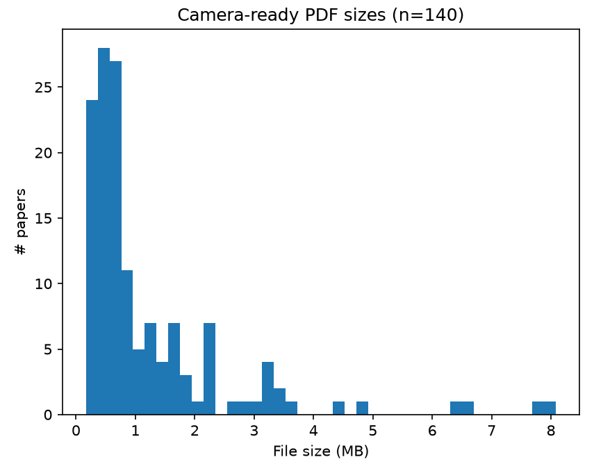
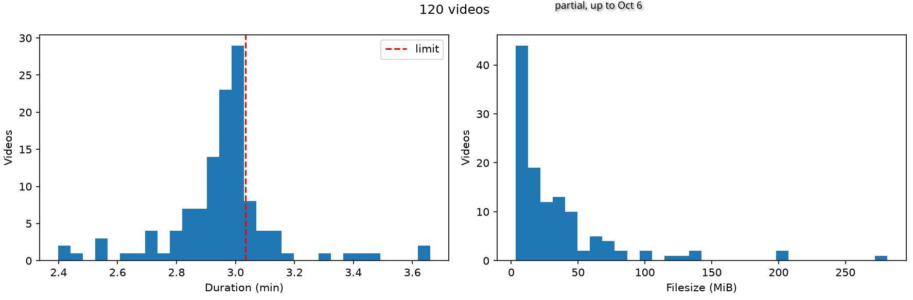

# Notes for Future ISMIRs

## Some statistics

## Notes

- Registration survey should ask for preferred email to join Slack
- Future hybrid confs should look into some kind of cheap synchronized colab whiteboard hardware for poster session. Tech-wise it should be realistic and cheap.
  - The poster whiteboard can be disentangled from the Zoom meeting.
- Should YouTube videos use miniconf thumbnails?
- [EARLY IN TIMELINE] Photo/video collection informed consent.
  - Finalize the plan of photo and video recording before opening registration.
  - In the registration form, inform the user of the plan. Registration is conditioned on either consent or one of the supported accommodations. If none is acceptable, the user should clarify their needs with the committee before registering.
  - Once the participant finished registering, there is not guaranteed way to reach them. Further surveys will always have missing respondents. The Opening Session of ISMIR is optional to attend.
- Give a short registration ID (could just count up from REG0001) to each registrant. This identifies them for Google Form responses, avoiding fuzze name/email matching.
  - Alternatively, use URL param identification via mailgun + specialized survey platform.
- Promoting external panelists in Webinar is challenging. Seems an inherent limitation of Zoom Webinar. It's worthy to brainstorm better solutions.
- Backend.
  - Current limitations without backend:
    - Miniconf is static.
    - No registration/identity tracking without 3-rd party platforms.
    - Google Form is not the most ergonomic. Why does the author need to check CMT ID every time? Best: search paper via keywords, select paper. See current database, update...
  - Current rationale:
    - Backend is more expensive.
    - Backend is more vulnerable.
  - Truth:
    - Backend is getting cheaper.
    - More AI agents are on the offensive, so security will be indeed difficult. But keeping the backend simple should help with security.
  - Successful experiments:
    - Liwei's Live Overview and Warm-up Discussion Board.
    - Xinyue's Volunteer Schedule.
- 1 recurring thing during conf was the limitation of no-parallel-webinar for 1 zoom user. Zoom does not even allow concurrent webinar+meeting. So most likely 3 licenses are required (e.g. tutorials, prep room/poster || oral, etc.). Once schedule is done, there's a puzzle to solve to make back to back sessions use diff users, so that setup for the next session can happen during the previous session.
- google slides: inserted media content also needs public permission. Remind authors.
- Webinar: use "attendee follows hosts view" and switch between gallery / speaker view appropriately.
